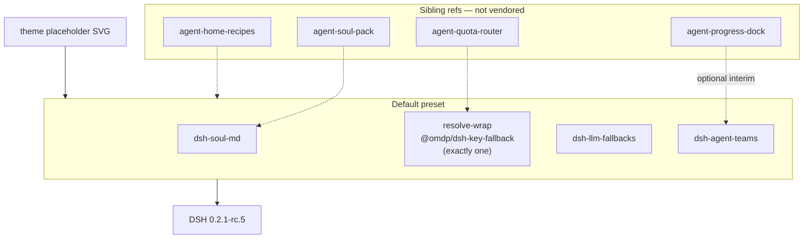

# agent-fleet-preset


**[☕ Buy Me a Coffee](https://buymeacoffee.com/kinfxhk)** · [GitHub Sponsors](https://github.com/sponsors/Kinfxhk)

**狀態：M0 scaffold（白標 Fleet 起步：預設插件清單＋主題佔位＋teams）——不是完整編排引擎，亦不像素抄任何商業 Bot UI。**

KINFX **L4** 白標 Fleet 預設：一個 resolve-wrap、teams 起步、主題 stub。  
**同 DeepSeek、xAI 或其他 LLM 廠商無隸屬關係。** Not affiliated with DeepSeek, xAI, or other LLM vendors. 技術段可寫「相容 DSH（DeepSeek Harness）」。

## English (short)

M0 **white-label fleet starter**: default plugin list, theme placeholder (not a commercial Bot UI clone), teams starter. Exactly one resolve-wrap (`@omdp/dsh-key-fallback`). Pin `@deepseek-ai/dsh@0.2.1-rc.5`. Progress is **optional/interim** (see `agent-progress-dock` / teams) — **do not** productize `allow-version`. References sibling recipes/quota/soul/progress by name only. MIT. No secrets.

## 架構示意



## 預設插件（M0）

| 角色 | 套件 | 備註 |
|------|------|------|
| Host | `@deepseek-ai/dsh@0.2.1-rc.5` | 釘 tip |
| Soul | `dsh-soul-md` | 人設卡；模板見 `agent-soul-pack` |
| Resolve-wrap（**只一個**） | `@omdp/dsh-key-fallback` | 禁雙 wrap |
| Model 降級 | `dsh-llm-fallbacks` | |
| Teams | `@nanmicoder/dsh-agent-teams` | activity／teams 起步 |
| Progress | （不入預設） | optional／interim：`agent-progress-dock`；**禁**產品化 `allow-version` |
| 可選替代 wrap | `@goodandready/dsh-key-rotation` | **代替** key-fallback，不並裝 |
| 禁裝 | `dsh-subagent-progress`、`dsh-bridges` | 對 0.2.1-rc.5 不相容 |

詳見 [`profiles/default/COMPATIBILITY.md`](profiles/default/COMPATIBILITY.md) · [`docs/theme-placeholder.md`](docs/theme-placeholder.md)

## 一鍵安裝（可逆）

```bash
cd /path/to/agent-fleet-preset
export DSH_HOME="${DSH_HOME:-$HOME/.agent-fleet-preset-dsh}"
mkdir -p "$DSH_HOME"
npm i -g @deepseek-ai/dsh@0.2.1-rc.5

npm run install:preset              # dry
npm run install:preset -- --apply   # 需要 dsh + DSH_HOME

# 可選：人設模板（L0 recipe 亦有 profiles/default/soul.md 模式）
# (cd ../agent-soul-pack && npm run install:templates -- --apply)

npm run healthcheck -- --dry
```

金鑰只放 `$DSH_HOME/.credentials.yaml`。本庫只有空的 [`.env.example`](.env.example)。

### 卸載

```bash
npm run uninstall:preset -- --apply
# 或 rm -rf "$DSH_HOME"
```

## 檢查

```bash
npm run check          # 檔案／preset 政策／health --dry／secret 粗掃
npm run healthcheck -- --dry
```

## 合規

不像素抄任何商業 Bot UI。公開產品名避裸 DeepSeek／Grok 品牌。  
多帳／多 key 自動輪換可能受供應商 ToS 限制——正式使用前開頁核實；本專案**不**提供繞過步驟，亦**不**建議 `allow-version` 當產品預設。

*Not legal advice; users must comply with each provider’s Terms/AUP; no secrets in git.*

## 授權

MIT · Copyright (c) 2026 KINFX · 見 [LICENSE](LICENSE) / [NOTICE](NOTICE)
